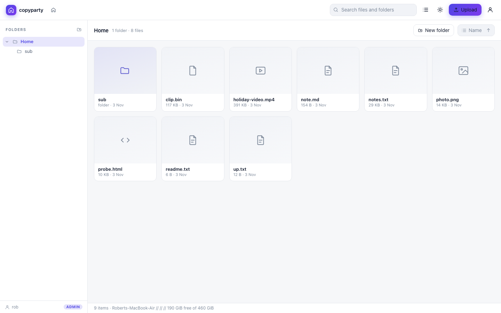
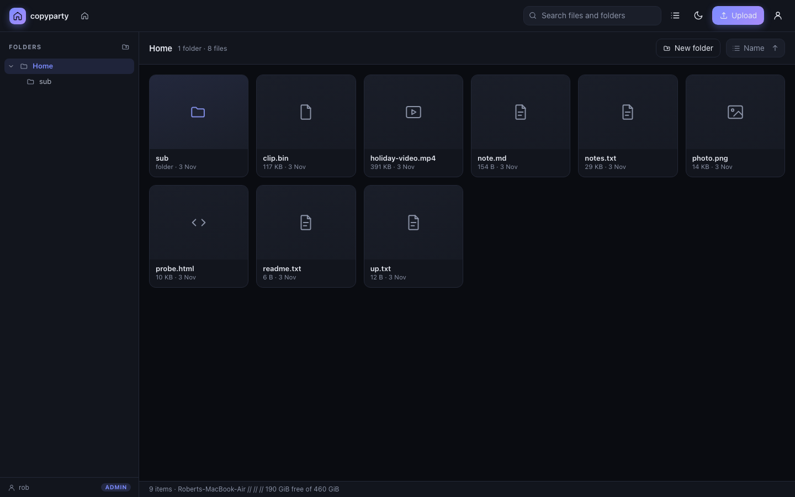
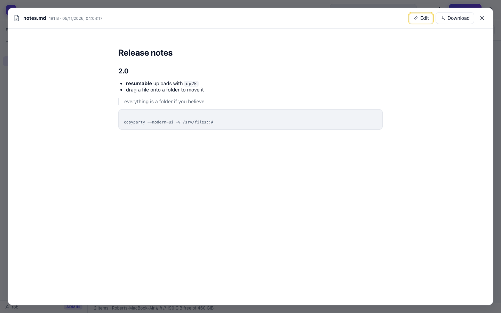
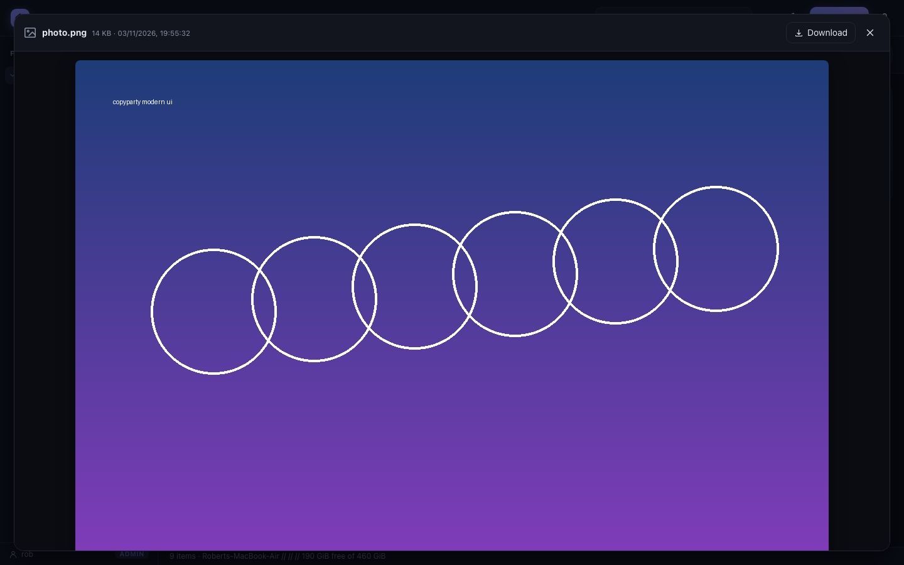
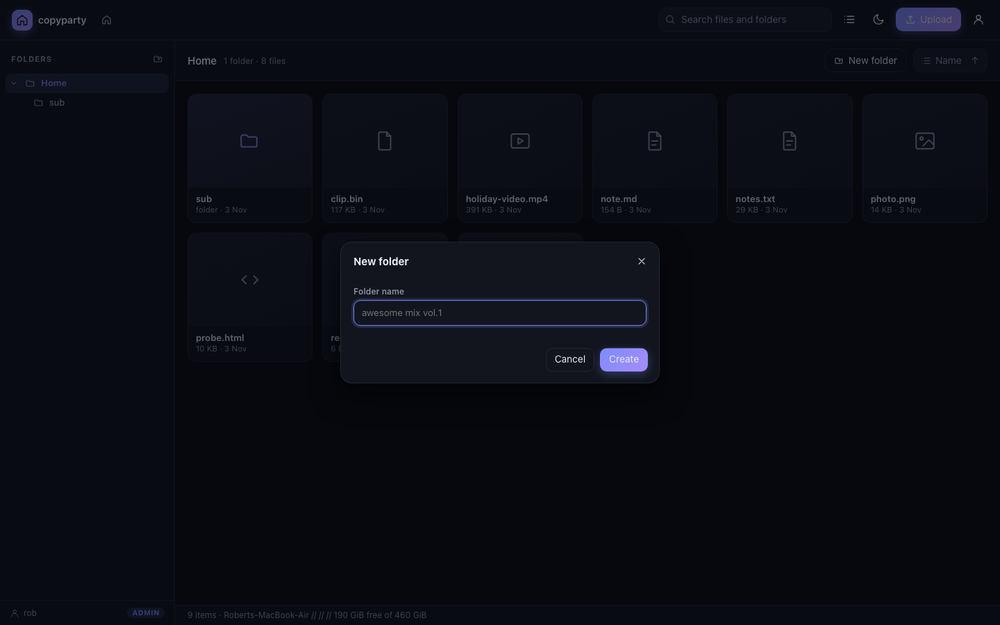
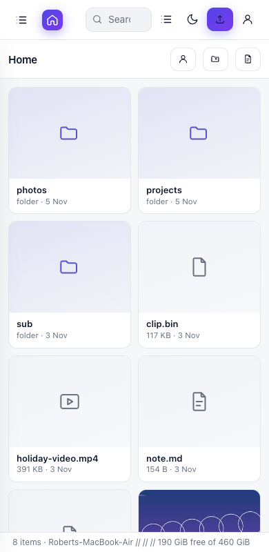
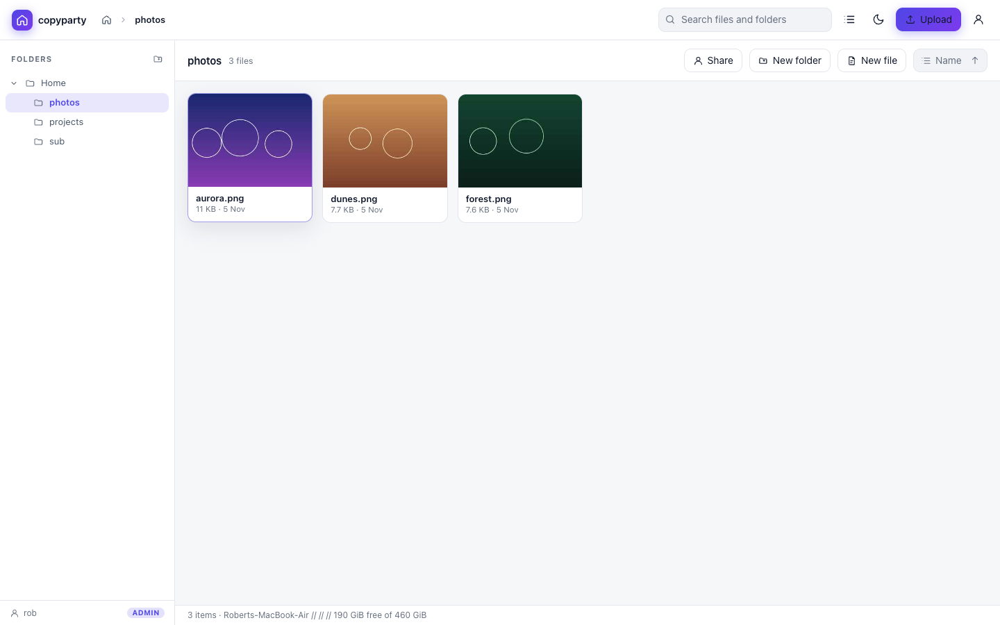

# modern ui

A modern filebrowser for copyparty: a no-build-step, dependency-free client
layer that replaces the classic filebrowser with a cleaner, faster interface
while keeping every one of copyparty's server-side features and permissions.



## quick start

```sh
cp -r copyparty/web/ui copyparty/web/    # already in the tree when running from source
python3 -m copyparty --modern-ui -v /srv/files::A
```

That is the whole install. `--modern-ui` serves the new interface on the normal
filebrowser URL; nothing else changes. The classic UI is still rendered
underneath, so:

* `?b=u` (the basic, no-javascript browser) keeps working
* `?h` (the admin/control panel) keeps working
* if the new bundle fails to load, the classic UI is revealed automatically
* without `--modern-ui`, copyparty behaves exactly as upstream

### without the flag

The UI is a normal client-side layer, so it can also be loaded the generic way:

```sh
copyparty \
  --css-browser=/.cpr/w/ui/ui.css \
  --js-browser=/.cpr/w/ui/boot.js
```

### inside a config file

```ini
[global]
  modern-ui
```

## what it does

| area | behaviour |
| --- | --- |
| browsing | grid and list views, breadcrumbs, lazily-loaded folder tree, sorting by name/size/type/date |
| search | instant filtering of the current folder, plus copyparty's server-side global search when its index is enabled |
| preview | images, video, audio, PDF, plain text, and rendered markdown, in an overlay viewer |
| file ops | create folder, rename, move, delete, download, zip a folder — all gated by the permissions the server reports |
| upload | drag-and-drop anywhere (or the Upload button): resumable, chunked up2k uploads when the page is on https or localhost, falling back to the classic multipart uploader otherwise; per-file hashing/sending progress, cancel and retry |
| big folders | entries are rendered 200 at a time with a "show more" control |
| editor | edit text/code/markdown in a monospace dialog (ctrl/cmd-s saves) |
| move | drag a file or folder onto the tree / breadcrumb, or use Move to... |
| shares | create a read-only share link with an optional password and expiry, when the server has `--shr` configured |
| tags | shows a Tags column when the server has a tag index |
| thumbnails | server-side thumbnails in the grid, with a type-icon fallback |
| auth | sign in / sign out, per-user permissions, `--usernames` and password-only servers both supported |
| theming | dark and light, follows the OS by default, remembered per browser |
| keyboard | `/` search, `Esc` close/clear, `Backspace` up one folder, `F2` rename, `Delete` delete, `Ctrl/Cmd-A` select all, `Enter` open, arrows walk the listing |
| languages | english and german, following the server's language setting, switchable in the account dialog |
| accessibility | dialogs take and trap focus and return it to whatever opened them, the listing has list semantics, buttons have accessible names, status and toasts are live regions |
| links | sort, direction, view and the search query live in the location hash, so a reload or a shared URL reproduces the view |
| responsive | single-column layout with an overlay folder drawer on phones |



## architecture

The whole UI is plain ES modules. There is no bundler, no transpiler, no
`node_modules`, and no build step — the browser loads the files exactly as they
are on disk.

```
copyparty/web/ui/
  boot.js     classic script; injects the stylesheet and the module entrypoint
  main.js     application: shell, views, navigation, dialogs, previews
  api.js      http layer against copyparty's existing endpoints
  up2k.js     resumable chunked uploader (sha-512 chunk hashes + wark)
  i18n.js     english-keyed translation table (en/de)
  dom.js      escaping, formatting, file-type helpers
  icons.js    inline svg icon set
  ui.css      design tokens, light/dark themes, layout, components
```

**It reuses copyparty's own endpoints** rather than inventing a new API, so
authentication, CSRF handling, dirkeys (`?k=`), and the permission model all
keep working:

| action | endpoint |
| --- | --- |
| list a folder | `GET <vpath>?ls=1` |
| create folder | `POST act=mkdir` |
| rename / move | `POST <vpath>?move=<dst>` |
| delete | `POST <vpath>?delete` |
| global search | `POST /?srch` (json body) |
| login / logout | `POST act=login` / `act=logout` |
| upload | up2k handshake + chunk `POST`s to the folder, or `POST act=bput` as a fallback |

The classic page stays mounted but hidden, so copyparty's own javascript never
sees its DOM disappear.

## server-side changes in this fork

Three small, isolated changes make the above possible:

1. `--modern-ui` flag (`copyparty/__main__.py`) — one switch instead of three.
2. injection of the loader (`copyparty/httpcli.py`) — for the browser template
   only, and only when the flag is set. The classic assets are untouched.
3. serving `/.cpr/w/ui/*` from disk (`copyparty/httpcli.py`) instead of the
   embedded `RES` manifest, so the UI can be edited without rebuilding.
4. `pyproject.toml` package-data entries so the files ship in wheels.

Everything else is additive; the fork rebases cleanly onto upstream.

## limitations

* **resumable uploads need a secure context.** sha-512 comes from WebCrypto, which
  browsers only expose on https or localhost. On a plain-http LAN the ui falls back
  to the classic uploader and says so in the queue; nothing breaks, you just lose
  resume and chunking.
* **global search needs the server's index** (`--idx` / `e2dsa`); without it,
  copyparty itself returns no hits, so the ui filters the current folder and says so.
* **thumbnails need the server's webdeps.** The ui asks for `?th=j` (copyparty
  takes a format code there, not a pixel size) and probes once per session; if
  the server cannot produce one it falls back to file-type icons. Both paths
  are verified here, with and without webdeps installed.
* **browser coverage:** chrome, webkit and firefox are all verified end to end
  (see the tests section). Their playwright builds had to be fetched with curl
  and extracted by hand because playwright's own downloader stalled here.
* **english and german only.** The classic ui ships ~30 translations; adding
  another language means adding one dictionary to `web/ui/i18n.js` (english
  strings are the keys). The language follows copyparty's own setting
  (`cplng` cookie / page `lang`), and can be changed in the account dialog.
* **tag editing and chmod are not implemented.** copyparty does not expose
  either over its http api, so there is nothing to call.
* dragging files/folders onto the folder tree (or a breadcrumb) moves them.

## tests

`tests/test_webui.py` starts a real copyparty and checks the integration --
flag, injection, `?b=u`, `?ls=1`, asset serving, traversal, and (when a chrome
is available) that the bundle mounts and renders:

```sh
python3 -m pytest tests/test_webui.py -q
```

The browser flows live in `tests/webui/e2e.js` (playwright): upload, preview +
url state, editor, share links, drag-to-move and dialog focus. Run it with

```sh
npm i playwright && npx playwright install webkit
CP_URL=http://127.0.0.1:3923 CP_USER=rob CP_PASS=secret node tests/webui/e2e.js chrome
```

All six steps pass on **chrome, webkit and firefox**. In a sandboxed
environment firefox needs `MOZ_DISABLE_CONTENT_SANDBOX=1`, because its own
content sandbox cannot initialise when nested inside another one.

## development

Edit the files in `copyparty/web/ui/` and reload the browser. To force a
reload of cached modules, bump the cachebuster by restarting copyparty
(`?_=<timestamp>` is appended to the entrypoint).

Syntax-check without any toolchain:

```sh
for f in copyparty/web/ui/*.js; do cp "$f" "/tmp/$(basename "$f").mjs"; node --check "/tmp/$(basename "$f").mjs"; done
```

## screenshots

| | |
| --- | --- |
|  |  |
|  |  |
|  | |
